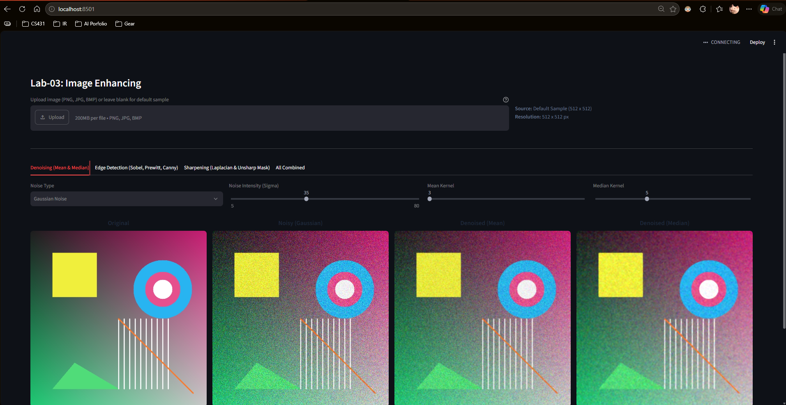
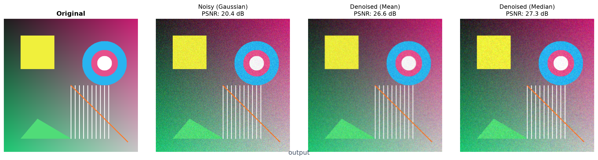
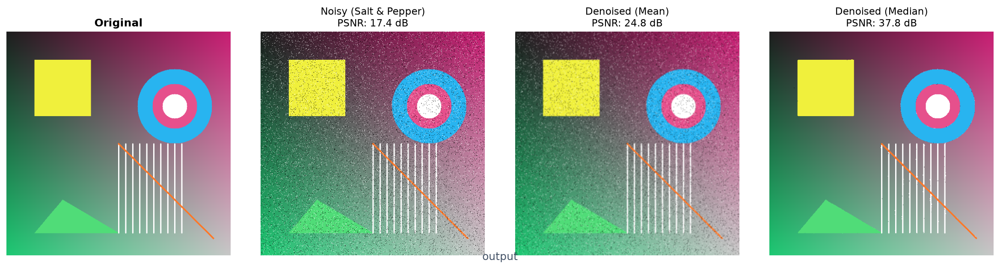
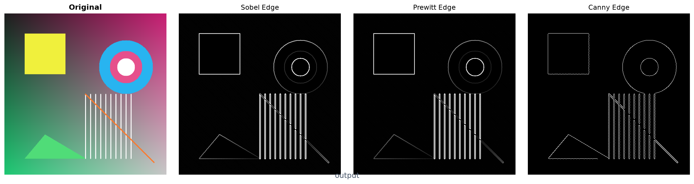
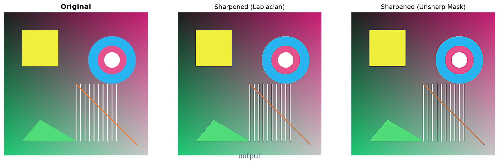
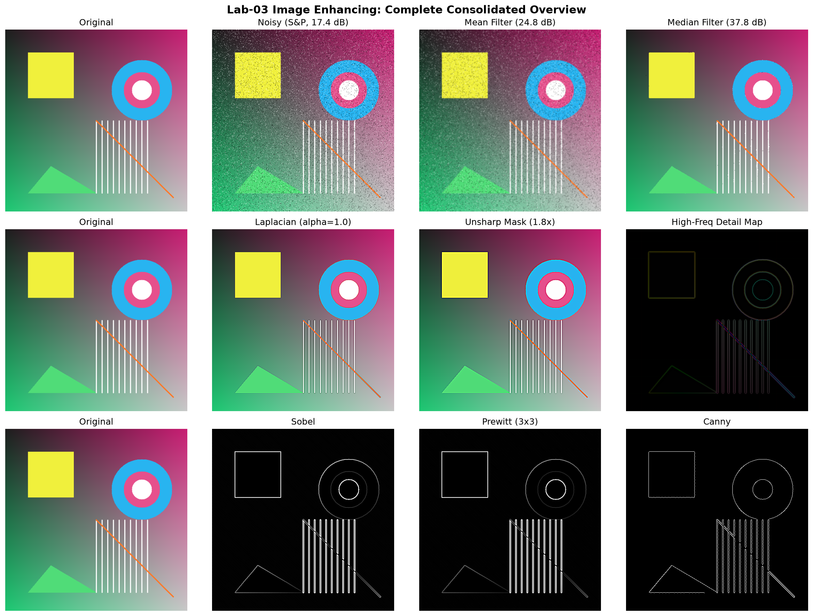

# Lab-03: Image Enhancing
- Môn học: Xử lý ảnh và ứng dụng
- Mã lớp: CS406.R11
- Sinh viên: Lương Quang Duy
- MSSV: 23520368

---

## 1. Giới thiệu dự án
Ứng dụng xử lý và nâng cao chất lượng ảnh số phục vụ bài thực hành Lab-03, bao gồm 3 chức năng chính:
- Khử nhiễu / Làm mịn ảnh: Lọc trung bình (Mean filter) và lọc trung vị (Median filter) trên hai mô hình nhiễu phổ biến là Gaussian noise và Salt & Pepper noise.
- Làm sắc nét ảnh: Tăng độ tương phản chi tiết bằng toán tử vi phân bậc hai Laplacian và kỹ thuật Unsharp Masking (High-boost).
- Phát hiện biên cạnh: Triển khai đồng thời cả 3 bộ lọc Sobel, Prewitt (ma trận 3x3 tùy biến) và Canny Edge.

---

## 2. Hướng dẫn cài đặt và khởi chạy

Dự án sử dụng công cụ quản lý package và môi trường ảo `uv`.

### Cài đặt môi trường:
```bash
# Clone dự án
git clone https://github.com/duylw/cs406-lab03.git
cd cs406-lab03

# Đồng bộ môi trường và cài đặt thư viện
uv sync
```

### Các lệnh thực thi:

1. Khởi chạy giao diện Web tương tác (Streamlit):
```bash
uv run streamlit run app.py
```
Truy cập ứng dụng trên trình duyệt tại: `http://localhost:8501`



---

## 3. Hình ảnh kết quả minh họa

### 3.1. Khử nhiễu và làm mịn (Denoising)

- Kết quả trên nhiễu Gauss:


- Kết quả trên Salt & Pepper Noise:


---

### 3.2. Phát hiện biên cạnh (Sobel, Prewitt, Canny)
Hiển thị đồng thời kết quả trích xuất biên cạnh từ cả 3 bộ lọc:


---

### 3.3. Làm sắc nét ảnh (Sharpening)
So sánh giữa ảnh gốc và kết quả sau khi làm sắc nét qua Laplacian và Unsharp Masking:


---

### 3.4. Tổng hợp toàn bộ các kết quả xử lý

